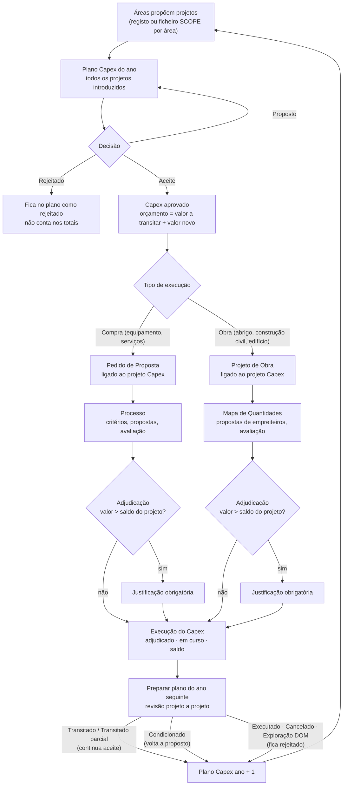
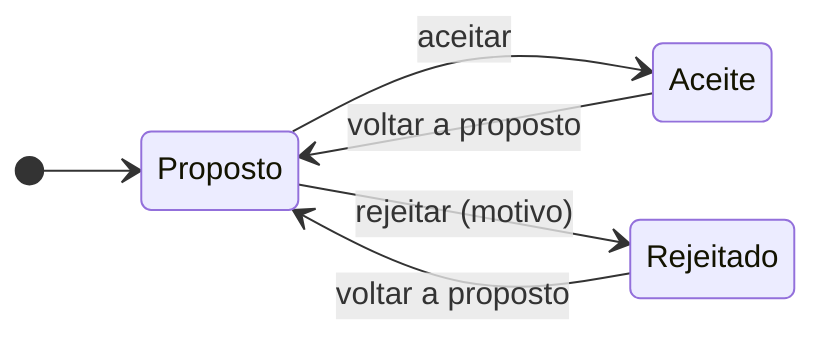

# Plataforma DEI — fluxo do projeto e base de dados

Versão visual: página "Mapa da Plataforma DEI" (claude.ai). Os diagramas abaixo são os mesmos, em Mermaid.

## Fluxo do projeto

Cada área (DEP-INF, DEP-PRCS, DEP-PRM, DEP-SAF) propõe os seus projetos no plano do ano. Só os projetos **aceites** formam o Capex e só esses podem ter compras (Pedido → Processo) ou obras (Projeto de Obra). O adjudicado volta ao projeto como execução e, no fim do ano, decide o que transita.

## Aprovação dos projetos

## Regras

- Pedidos de Proposta e Projetos de Obra novos têm de escolher um projeto Capex **aceite** (os registos antigos podem ficar sem projeto).
- Adjudicação (Processo ou Obra): se o adjudicado nas outras compras/obras do projeto + o valor a adjudicar ultrapassar o TOTAL ORC., a justificação é obrigatória.
- Execução = adjudicado (processos em CVE + obras) / em curso (orçamento estimado dos pedidos + valor estimado das obras sem adjudicação). Cancelados não contam.
- Projeto com compras ou obras não pode ser rejeitado nem apagado; recarregar o ficheiro de uma área só substitui os projetos dessa área.
- Plano do ano seguinte: valor a transitar sugerido = orçamento − adjudicado. Transitado/parcial → aceite; Condicionado → proposto; Executado/Cancelado/Exploração DOM → rejeitado.

## Base de dados

