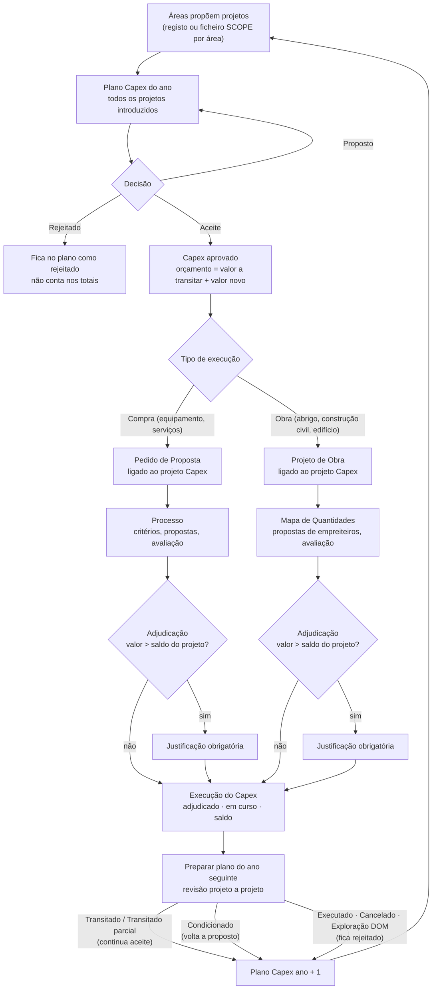
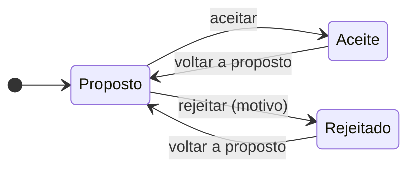
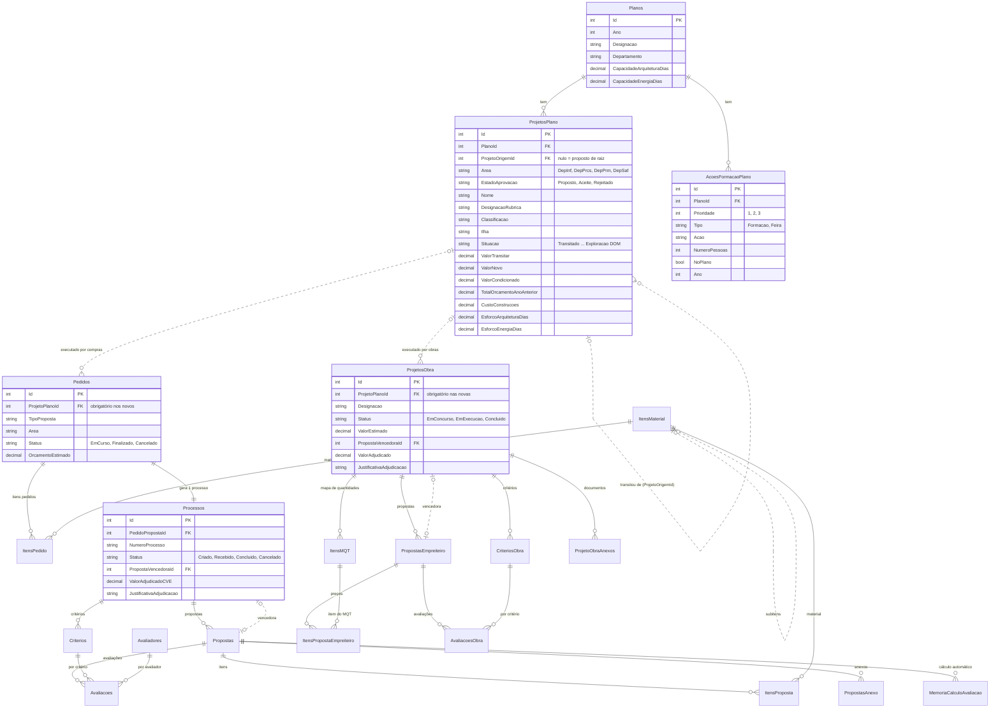
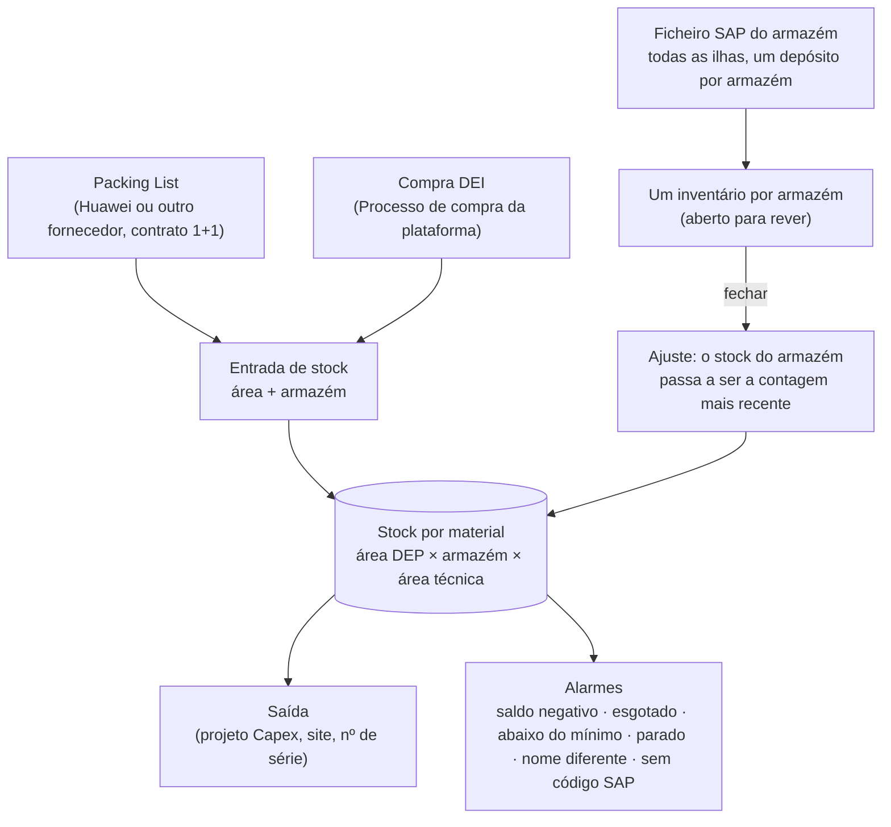
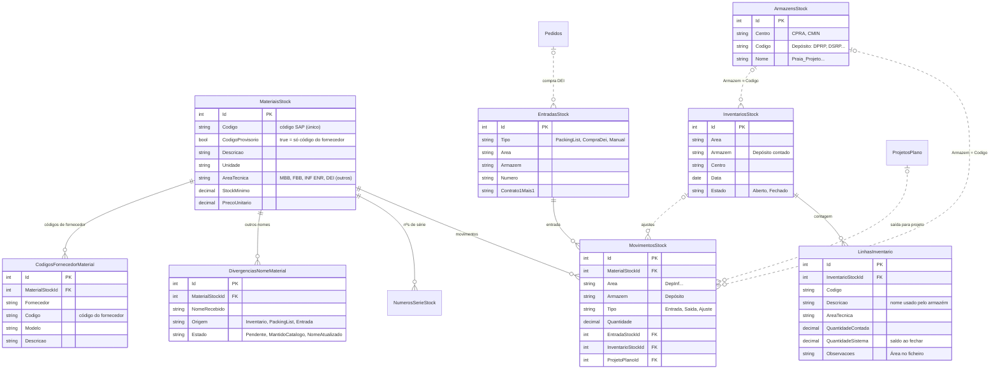

# Plataforma DEI — fluxo do projeto e base de dados

Versão visual: página "Mapa da Plataforma DEI" (claude.ai). Os diagramas abaixo são os mesmos, em Mermaid.

## Fluxo do projeto

Cada área (DEP-INF, DEP-PRCS, DEP-PRM, DEP-SAF) propõe os seus projetos no plano do ano. Só os projetos **aceites** formam o Capex e só esses podem ter compras (Pedido → Processo) ou obras (Projeto de Obra). O adjudicado volta ao projeto como execução e, no fim do ano, decide o que transita.

## Aprovação dos projetos

## Regras

- Pedidos de Proposta e Projetos de Obra novos têm de escolher um projeto Capex **aceite** (os registos antigos podem ficar sem projeto).
- Adjudicação (Processo ou Obra): se o adjudicado nas outras compras/obras do projeto + o valor a adjudicar ultrapassar o TOTAL ORC., a justificação é obrigatória.
- Execução = adjudicado (processos em CVE + obras) / em curso (orçamento estimado dos pedidos + valor estimado das obras sem adjudicação). Cancelados não contam.
- Projeto com compras ou obras não pode ser rejeitado nem apagado; recarregar o ficheiro de uma área só substitui os projetos dessa área.
- Plano do ano seguinte: valor a transitar sugerido = orçamento − adjudicado. Transitado/parcial → aceite; Condicionado → proposto; Executado/Cancelado/Exploração DOM → rejeitado.

## Base de dados

## Gestão de Stock

Materiais comprados pela DEI e guardados em armazém. O stock de cada material **não se guarda**: calcula-se pelos movimentos (entradas, saídas e ajustes de inventário), por **área DEP** (DEP-INF, DEP-PRCS, DEP-PRM, DEP-SAF) e por **armazém**.

### Armazéns (Centro / Depósito do SAP)

O ficheiro do SAP do armazém traz **todas as ilhas** no mesmo Excel (uma folha por ilha). Cada linha diz o **Centro** e o **Depósito**, e a coluna **Observações** dá a designação do armazém. A plataforma cria o armazém automaticamente na primeira vez que o depósito aparece (ex.: Santo Antão, São Nicolau, Maio ou Brava entram da mesma forma).

| Centro | Depósito | Armazém | Ilha | Entra no stock DEI |
|---|---|---|---|---|
| CPRA | DPRP | Praia_Projeto | Santiago | Sim — linhas DEI / AIRPON / ENERGIA (coluna Área) |
| CPRA | DSRP | SAL_Projeto | Sal | Sim — todo o armazém |
| CPRA | DBRP | Boavista_Projeto | Boa Vista | Sim — todo o armazém |
| CPRA | DFRP | Fogo_S.Filipe_Projeto | Fogo | Sim — todo o armazém |
| CMIN | DMRP | S.Vicente_Mindelo_Projeto | São Vicente | Sim — todo o armazém |
| CPRA | DBVS | Boavista_Técnico | Boa Vista | Não (técnico) |
| CPRA | DFIL | Fogo_S.Filipe_Técnico | Fogo | Não (técnico) |
| CMIN | DMIN | S.Vicente_Mindelo_Técnico | São Vicente | Não (técnico) |
| CMIN | DGRM | S.Vicente_D Gest Rede Mind | São Vicente | Não (técnico) |

Colunas lidas: `Centro`, `Depósito`, `Material` (código = ID do material), `TxtBreveMaterial` (descrição), `Contagem` / `Contagem Total`, `Utiliz.livre` (unidade), `Observações` (armazém) e `Área` (projeto, quando existe).

### Que materiais entram (DEI, AIRPON, ENERGIA) e área técnica

Na importação indica-se as áreas a trazer (por omissão `DEI, AIRPON, ENERGIA`):

- Folhas **com** a coluna Área: entra a linha cuja Área tem uma dessas palavras (DEI_FTTH, DEI_TORRE, AIRPON, ENERGIA_Projeto Power Mindelo, "RAM, ENERGIA"…).
- Folhas **sem** a coluna Área (SAL, Boavista, Fogo, S.Vicente…): os **armazéns de Projeto** (Observações com "Projeto": SAL_Projeto, Boavista_Projeto, Fogo_S.Filipe_Projeto, S.Vicente_Mindelo_Projeto…) **são da DEI e entram inteiros**; a área técnica vem do mesmo código noutra folha (ex.: DEI_FTTH na Praia) ou fica DEI (outros). Os armazéns **Técnico** e outros (Boavista_Técnico, Fogo_S.Filipe_Técnico, S.Vicente_Mindelo_Técnico, D Gest Rede) **não são DEI e ficam de fora**.

A área técnica fica no material (dentro da área DEP, ex.: DEP-INF) e pode ser filtrada no inventário e no stock:

| Área no ficheiro do armazém | Área técnica |
|---|---|
| DEI_TORRE | MBB |
| DEI_FTTH, AIRPON | FBB |
| ENERGIA (todas as variantes) | INF ENR |
| outras DEI (DEI, DEI PROJETO, DEI_RAM…) | DEI (outros) |
| armazém de Projeto sem área no ficheiro | DEI (outros) |

### Código SAP e códigos de fornecedor

O **código SAP** (coluna `Material` do ficheiro do armazém, ex.: 20076) é o **ID oficial** do material. Os fornecedores usam os seus próprios códigos (ex.: Part Number da Huawei `01076667`) e a DEI controla essa correspondência:

- Cada material tem a lista **Códigos de fornecedor** (fornecedor, código do fornecedor, modelo, descrição do fornecedor), na ficha do material.
- **Packing List**: o código da linha é do fornecedor. Se já estiver associado a um código SAP, a entrada vai **diretamente** para esse material. Se não, o material fica **provisório — "sem código SAP"** (alarme *Sem código SAP*).
- **Associar ao código SAP** (ficha do material): se o código SAP já existe no stock, os dois **juntam-se** (stock, movimentos, nºs de série, contagens e códigos passam para o material SAP); se não existe, o material passa a ter esse código SAP. O código do fornecedor fica registado e as próximas entradas com ele vão diretas.
- Compras DEI e entradas manuais usam o código SAP.
- A pesquisa do stock encontra o material pelo código SAP ou por qualquer código de fornecedor.
- O mesmo código SAP genérico (ex.: "Poste") pode ter vários códigos de fornecedor / modelos associados.

### Regras do inventário

- **Importar o ficheiro SAP** (Inventário → "Importar o ficheiro do SAP do armazém") cria **um inventário aberto por armazém**, com a área DEP e a data escolhidas.
- **Fechar** um inventário de um armazém acerta **só o stock desse armazém**: a diferença para o saldo da plataforma fica como movimento de Ajuste. Um inventário novo do mesmo armazém volta a acertar — fica sempre a **contagem mais recente**.
- Opção ao fechar **"Não contados passam a 0"**: o que tinha stock no armazém e não aparece na nova contagem fica a zero.
- Materiais novos são criados no catálogo ao fechar (com a área técnica da linha). O nome do catálogo não é substituído: se o armazém usar outro nome para o mesmo código, fica o alerta **Nome diferente** para decidir (manter o nome do catálogo ou usar o nome recebido).
- Um inventário fechado não pode ser apagado; um aberto pode.
- Entradas (Packing List, compras) e saídas também indicam o armazém; a saída valida o stock do armazém escolhido.

### Base de dados — Stock

